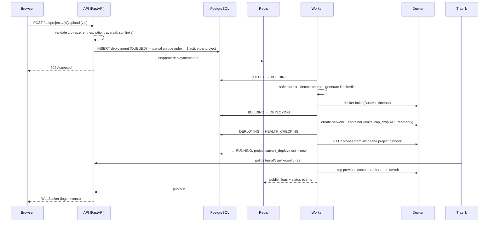
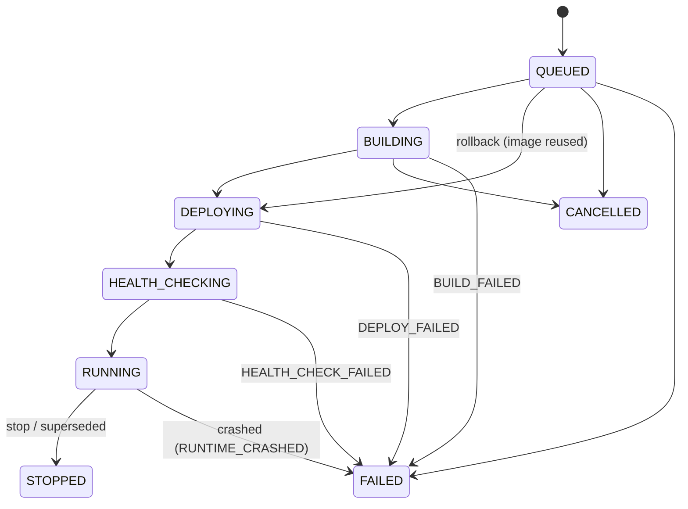

# Mini PaaS — Architecture

This document records the architecture and the decisions behind it (lightweight ADRs).
The README explains how to run the platform; this file explains *why* it is built this way.

## 1. System overview

```
                         ┌──────────────┐
                         │   Browser    │
                         └──────┬───────┘
                                │  http://localhost  ·  http://<slug>.localhost
                                ▼
                     ┌─────────────────────┐
                     │  Traefik (edge)     │  file provider: platform routes
                     │  :80                │  http provider: app routes (from API)
                     └───┬──────────┬──────┘
           platform net  │          │  one bridge network per project
              ┌──────────┘          └───────────────┐
              ▼                                     ▼
   ┌──────────────────┐  ┌──────────────┐   ┌────────────────┐
   │ frontend (nginx) │  │ backend API  │   │ user app        │  cap_drop ALL, no-new-privs,
   │ React SPA        │  │ FastAPI      │   │ container(s)    │  cpu/mem/pids limits, non-root,
   └──────────────────┘  └──┬────────┬──┘   └────────────────┘  read-only rootfs, no socket
                            │        │              ▲
                     ┌──────┘        └──────┐       │ docker API (only these two services)
                     ▼                      ▼       │
              ┌────────────┐         ┌───────────┐  │
              │ PostgreSQL │◄────────┤  Redis    │  │
              └────────────┘         └─────┬─────┘  │
                     ▲   broker / pubsub   │        │
                     │       ┌─────────────┴──┐     │
                     ├───────┤ worker (Celery)├─────┤  build · deploy · stop · rollback · cleanup
                     │       └────────────────┘     │
                     │       ┌────────────────┐     │
                     └───────┤ agent          ├─────┘  runtime log collector · metrics · crash watcher
                             └────────────────┘
```

| Service     | Image / target          | Docker socket | Purpose                                                   |
|-------------|-------------------------|---------------|-----------------------------------------------------------|
| `proxy`     | traefik v3              | **no**        | Edge router. Platform + app host-based routing            |
| `frontend`  | `frontend/Dockerfile`   | no            | Static SPA served by unprivileged nginx                   |
| `backend`   | `backend` target `api`  | **no**        | REST API, WebSockets, Traefik dynamic config endpoint     |
| `migrate`   | `backend` target `api`  | no            | One-shot `alembic upgrade head` before the API starts     |
| `secrets-init` | target `api`         | no            | One-shot: generates per-installation secrets              |
| `worker`    | target `worker`         | yes           | Celery `deployments` queue: builds and deploys            |
| `ops-worker`| target `worker`         | yes           | Celery `ops`/`maintenance`: stop, restart, delete, cleanup |
| `scheduler` | target `api`            | no            | Celery beat: cleanup, stale-deployment reaper, heartbeats |
| `agent`     | target `worker`         | yes           | Follows app logs, samples `docker stats`, watches crashes |
| `postgres`  | postgres 17             | no            | System of record                                          |
| `redis`     | redis 7                 | no            | Celery broker, pub/sub for live logs/events, rate limits  |

## 2. Request and deployment flow



## 3. Decisions

**ADR-1 Traefik as edge proxy, nginx only for static files.** App routes change at runtime.
Traefik's HTTP provider polls `GET /internal/traefik/config` on the API, which renders routes
from PostgreSQL (the single source of truth). No reloads, no config files to template, and —
unlike Traefik's Docker provider — the proxy never needs the Docker socket. The frontend
container is nginx (unprivileged) serving the built SPA.

**ADR-2 Docker access is confined to `worker` and `agent`.** The API (internet-facing) has no
socket; it enqueues jobs. All Docker calls go through `app/docker/service.py` (`DockerService`).
Mounting the socket is root-equivalent on the host; this is the main residual risk of the
MVP and is documented in the README security section. Moving to a rootless daemon,
a socket proxy with an allow-list, or a remote builder (BuildKit/Kaniko) is on the roadmap.

**ADR-3 Images are built with BuildKit through the Docker CLI** (`docker build` subprocess,
argument list, no shell) instead of docker-py's `images.build`, which only drives the
deprecated classic builder. Runtime operations (containers, networks, stats, logs) use
the Docker SDK.

**ADR-4 One bridge network per project.** User containers cannot reach each other, the
database, Redis or the API. Traefik (and, transiently during health checks, the worker) is
attached to each project network. The agent reconciles these attachments if the proxy
restarts. Docker's default address pools allow ~30 networks; the README shows the
`default-address-pools` setting for larger installations.

**ADR-5 Async API, sync workers.** The API uses SQLAlchemy async + asyncpg (WebSockets and
many concurrent requests benefit). Celery tasks and the agent are blocking by nature
(Docker builds, subprocesses), so they use SQLAlchemy sync + psycopg. Models, the deployment
state machine, crypto, runtime detection and Docker abstractions are shared.

**ADR-6 Concurrency is enforced by the database.** A partial unique index on
`deployments(project_id) WHERE status IN (active states)` guarantees at most one active
deployment per project even under concurrent requests. Per-user caps are checked in the
service layer, and a Redis rate limiter throttles bursts.

**ADR-7 Auth: short-lived JWT access tokens + rotating opaque refresh tokens.** The access
token (15 min, HS256, `typ=access`, `iss`/`aud` checked) lives in memory in the SPA. The refresh
token is an httpOnly, `SameSite=Strict` cookie scoped to `/api/auth`, stored hashed, rotated
on every use, with reuse detection that revokes the whole token family. WebSockets
authenticate with single-use 30 s tickets so no JWT ends up in URLs or proxy logs.

**ADR-8 Secrets are encrypted at rest with Fernet (MultiFernet for rotation).** Environment
values are never returned by list endpoints when marked secret; revealing one is an
explicit, audited `POST`.

**ADR-9 Logs: PostgreSQL behind a sink interface.** Build/deploy logs are written by the
worker, runtime logs by the agent, both in batches through `LogSink`, which persists then
publishes on Redis pub/sub. Per-deployment byte caps and retention keep PostgreSQL healthy.
Swapping the persistence step for Loki/Elasticsearch only touches the sink.

**ADR-10 Layered backend instead of feature folders.** `api → services → repositories → models`
with `docker/`, `builds/`, `routing/`, `workers/`, `agent/` as infrastructure modules. Routers
contain no business logic and no SQL.

**ADR-11 Secrets generated per installation.** `secrets-init` writes random JWT, Fernet,
database and internal-token secrets once into a volume (`root:10001`, mode 0440). Settings read
them through `SECRETS_DIR`; explicit env vars override them and empty ones are ignored. No
secret ever lives in the repository or in `.env.example`, yet `docker compose up` works
out of the box.

**ADR-12 Locks without Lua.** The per-project lock uses `SET NX EX` and a `WATCH/MULTI`
compare-and-delete, so it behaves the same on Redis and Redis-compatible servers with partial
Lua support (found during development: redis-py's Lua release script silently failed there).

**ADR-13 Deploys and lifecycle operations use separate worker pools.** A long build can never
delay a user's *Stop* or *Restart*.

## 4. Deployment state machine



`FAILED` always carries a `failure_reason` (`BUILD_FAILED`, `DEPLOY_FAILED`,
`HEALTH_CHECK_FAILED`, `RUNTIME_CRASHED`, `TIMEOUT`, `INTERNAL_ERROR`) and an error message.
Invalid transitions raise and are never persisted (`app/deployments/state_machine.py`).

## 5. Implementation phases

1. Bootstrap: repo layout, compose, Traefik, Postgres, Redis, API skeleton, SPA skeleton
2. Auth · 3. Projects · 4. Data model + migrations
5. DockerService · 6. Build system · 7. Deployment workers · 8. Container lifecycle
9. Reverse proxy routes · 10. Logs · 11. Env vars · 12. Metrics
13. History · 14. Rollback · 15. Frontend · 16. Tests · 17. Hardening · 18. Docs
